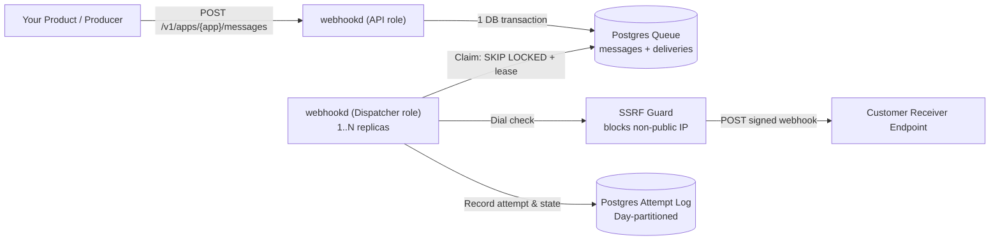
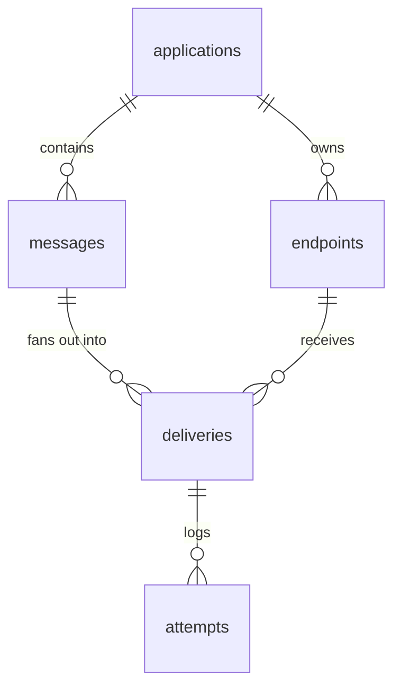
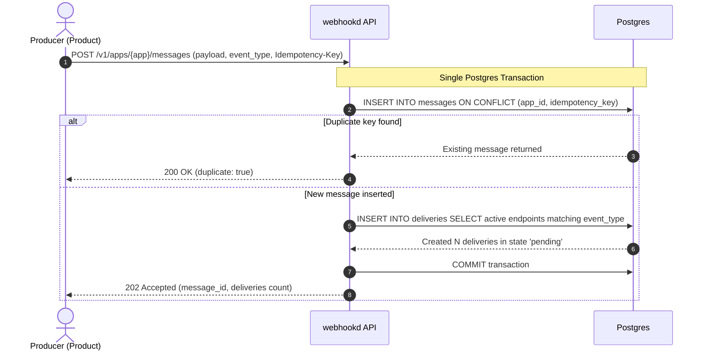
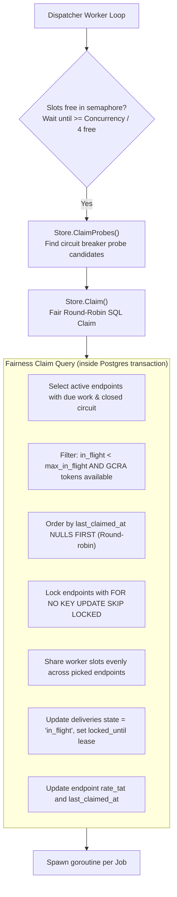
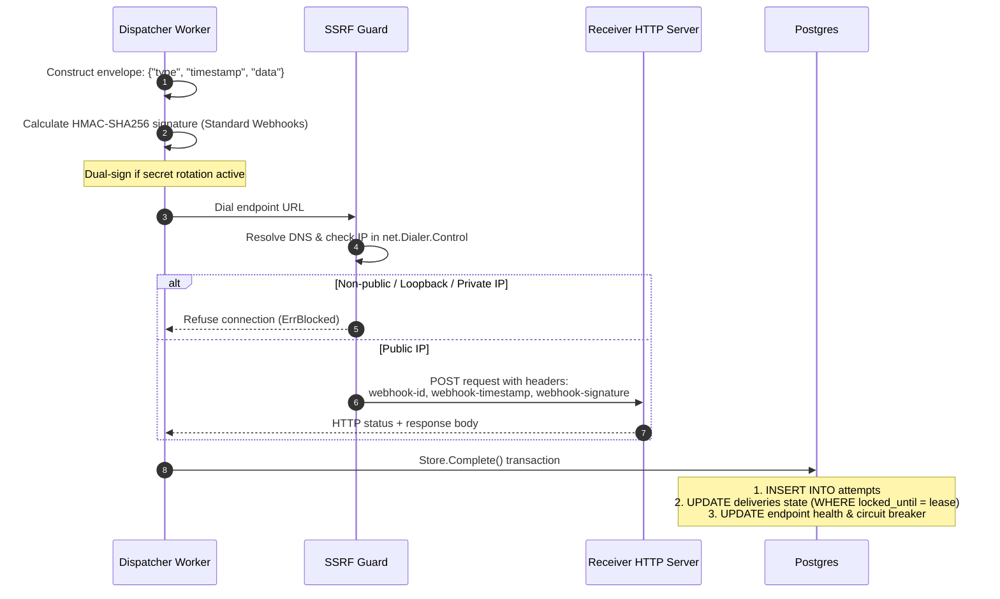
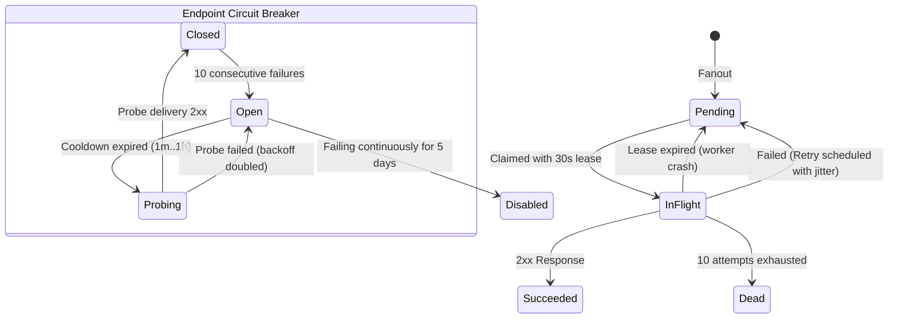

# Architecture & System Design

[`index.html`](index.html) is an interactive architecture diagram of the
service, made with [Archify](https://github.com/tt-a1i/archify). Open it in a
browser; every box links to the source lines it describes.

---

## System Overview

Self-hostable webhook delivery service. One Go binary, one Postgres database. No Kafka, Redis, or queue daemon needed.
Delivers messages at-least-once, unordered. Every message carries permanent `webhook-id`. Receivers deduplicate on ID.



## Binary Roles & Process Model

Single binary [`cmd/webhookd`](../../cmd/webhookd). Behavior controlled by `ROLE` environment variable:

- `api`: Serves REST API routes under `/v1` with bearer token auth ([`internal/api/api.go`](../../internal/api/api.go)).
- `dispatcher`: Claims due deliveries from Postgres, signs HTTP requests, dispatches them ([`internal/dispatcher/dispatcher.go`](../../internal/dispatcher/dispatcher.go)).
- `all` (default): Runs API and dispatcher concurrently in same process.

All roles expose `/healthz`, `/readyz`, `/metrics` (Prometheus), and `/openapi.json`.

## Data Model

Postgres tables act as state store and persistent work queue ([`internal/postgres/migrations/`](../../internal/postgres/migrations/)).



- **`applications`**: Tenant boundaries (`app_...`).
- **`endpoints`**: Target URLs, signing secrets, status (`active`, `paused`, `disabled`), subscribed `event_types`, concurrency cap (`max_in_flight`), rate limits (`rate_limit`, `rate_tat`).
- **`messages`**: Event payload, event type, optional idempotency key.
- **`deliveries`**: Individual queue item representing one message going to one endpoint. States: `pending`, `in_flight`, `succeeded`, `dead`.
- **`attempts`**: Audit log of every HTTP call. Range-partitioned by UTC day.

## Ingestion & Fanout Pipeline



Key guarantees in `Store.CreateMessage`:
- **Atomic fanout**: Message insertion and delivery generation occur inside single transaction. Crash cannot produce orphaned message without delivery records.
- **Idempotency**: Scoped to `(app_id, idempotency_key)`. Re-submitting returns previous message without re-enqueueing. Reusing a key with a different event type or payload returns `422`.

## Fair Queue Engine & Worker Claim

Dispatchers claim work straight from Postgres, no message broker. New messages and replays wake them through `LISTEN/NOTIFY`; a 250 ms poll catches retries coming due. Dispatcher handles rate limits, concurrency limits, and circuit breakers directly in SQL claim query.



Implementation details in `Store.Claim`:
- **Noisy neighbour isolation**: Slow endpoint cannot monopolize dispatcher. `max_in_flight` (default 4) caps concurrent dispatches per endpoint.
- **GCRA rate limiting**: Generic Cell Rate Algorithm tracks theoretical arrival time (`rate_tat`) inside endpoint row. Limits hold across all dispatcher replicas without Redis.
- **`FOR NO KEY UPDATE`**: Prevents foreign key lock contention between worker claim queries and API message ingestion.
- **Lease and fencing token**: Claim sets `locked_until` (default 30 seconds). `locked_until` acts as fencing token during completion update.
- **Sweeper loop**: `Dispatcher.releaseExpiredLoop` regularly resets abandoned `in_flight` rows past lease back to `pending`.

## HTTP Dispatch & Delivery Lifecycle



### Request Signing ([`internal/signing/signing.go`](../../internal/signing/signing.go))

Follows [Standard Webhooks spec](https://www.standardwebhooks.com/).

Headers sent:
- `webhook-id`: Message ID (`msg_...`).
- `webhook-timestamp`: Unix timestamp string.
- `webhook-signature`: `v1,<base64 HMAC-SHA256 of id.timestamp.body>`.

**Zero-downtime secret rotation**: Old secret stays active for configured window (default 24 hours). Dispatcher signs with both secrets; headers hold space-separated signatures ([`internal/dispatcher/dispatcher.go#L422-L430`](../../internal/dispatcher/dispatcher.go#L422-L430)).

### SSRF Protection ([`internal/ssrf/ssrf.go`](../../internal/ssrf/ssrf.go))

- Injected via custom `net.Dialer.Control`.
- Validates resolved IP right before socket connection.
- Rejects loopback, link-local metadata (`169.254.169.254`), private RFC1918, carrier NAT, and broadcast.
- Defeats DNS rebinding attacks. HTTP redirects intentionally not followed.

## Retries, Circuit Breaker & Health



### 1. Retry Schedule ([`internal/dispatcher/schedule.go`](../../internal/dispatcher/schedule.go))
- 10 attempts over 23 hours: 5s, 30s, 2m, 10m, 30m, 1h, 3h, 6h, 12h.
- Jitter: ±25% around base duration.
- Respects `Retry-After` header on HTTP 429 and 503 responses, capped at 24 hours.

### 2. Circuit Breaker ([`internal/postgres/queue.go#L325-L357`](../../internal/postgres/queue.go#L325-L357))
- Trips after 10 consecutive delivery failures.
- Normal claims pause for that endpoint.
- Initial cool-down: 1 minute.
- Once cool-down expires, `Store.ClaimProbes` claims single probe delivery.
- Success closes circuit and resets failure counter. Failure doubles cool-down (capped at 1 hour).

### 3. Auto-Disable
- 5 days continuous failures automatically changes endpoint status to `disabled`.
- Atomically dispatches `endpoint.disabled` system event to the app's endpoints subscribed to it (subscribe one, or alert on `webhookd_endpoints_disabled_total`).
- `POST /v1/apps/{app}/endpoints/{ep}/enable` restores endpoint to active and resets counters.

### 4. Replay
- Endpoints and deliveries support manual replay via API (`POST .../replay`).
- Delivery reset to pending with fresh retry schedule, preserving original `webhook-id` so receivers avoid duplicate actions.

## Day-Partitioned Attempt Storage

Attempt table records every HTTP interaction and error response body. It grows rapidly.
- Table partitioned by UTC day: `attempts_YYYYMMDD` ([`0004_partition_attempts.sql`](../../internal/postgres/migrations/0004_partition_attempts.sql)).
- Hourly maintenance task (`Store.MaintainAttemptPartitions`) pre-creates upcoming 7 days of partitions.
- Partitions older than retention days (configured via `ATTEMPT_RETENTION_DAYS`) dropped instantly via `DROP TABLE`.
- Avoids bloat and heavy table-locking `DELETE` queries.

Messages and their deliveries are kept for `MESSAGE_RETENTION_DAYS` (30) once every delivery has finished, then deleted in small batches by the same hourly task. Unfinished messages are never deleted.

## SDK & Developer Tools

- [`webhooks`](../../webhooks/): Go SDK containing API client and `VerifyRequest` helper for webhook receivers.
- [`cmd/webhookctl`](../../cmd/webhookctl): CLI tool for managing apps, endpoints, secret rotation, sending events, viewing attempts, triggering replays.
- [`cmd/mockreceiver`](../../cmd/mockreceiver): Test HTTP server verifying HMAC signatures, simulating configurable failure rates and latency.
- [`cmd/loadgen`](../../cmd/loadgen): Benchmarking tool measuring throughput and delivery lag under load.

## Repository Code Map

| Directory / File | Responsibility |
| --- | --- |
| [`cmd/webhookd/main.go`](../../cmd/webhookd/main.go) | Service entry point; boots API, dispatcher, or both. |
| [`internal/api/`](../../internal/api/) | HTTP route routing, auth check, input validation, ops handlers. |
| [`internal/dispatcher/`](../../internal/dispatcher/) | Dispatcher loop, concurrency semaphore, HTTP client dispatch, partition maintenance. |
| [`internal/postgres/`](../../internal/postgres/) | Database connection, migrations, store methods, queue claim queries, health updates. |
| [`internal/signing/`](../../internal/signing/) | Standard Webhooks HMAC signing and header verification. |
| [`internal/ssrf/`](../../internal/ssrf/) | `net.Dialer.Control` security filter blocking non-public network addresses. |
| [`webhooks/`](../../webhooks/) | Go client library and receiver verification utilities. |
| [`docs/openapi.json`](../openapi.json) | OpenAPI 3.1 specification validated by contract tests. |

---

## Interactive Architecture Diagram (Archify)

[`architecture.json`](architecture.json) is the source for the interactive Archify diagram in [`index.html`](index.html). To regenerate the page after editing it, from the repository root (needs Node 18+ and Chrome or Chromium):

```sh
git clone --depth 1 https://github.com/tt-a1i/archify /tmp/archify
node /tmp/archify/archify/bin/archify.mjs finalize architecture \
  docs/architecture/architecture.json docs/architecture/index.html \
  --repo-root . --quality showcase
```

The README's images, `architecture-light.png` and `architecture-dark.png`,
are the diagram exported from the page's Export menu (PNG) in each theme;
re-export them after regenerating.

Set `meta.repository.revision` to a pushed commit first: the source links
point at that commit.
